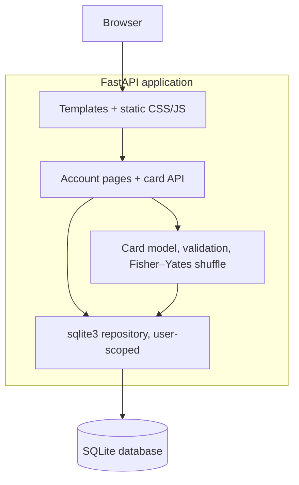

# Architecture (as built, 2026-11-24)

**Status:** Implemented and tested locally. HTTPS deployment and SQLite backups remain backlog work (`BL-022`, `BL-023`). This document describes the code in `src/virtual_index_card/`, not a proposal.

## Product shape

A hosted FastAPI web application with one private deck per account. Notes are plain text; each card has a front and back. The management page lists cards newest-created first for CRUD; Review shows one card at a time in the saved deck order and is the only page offering a shuffle control. Shuffle order is stored in SQLite and survives reloads, independently of the management view's creation order.

## Components

| File | Responsibility |
|---|---|
| `app.py` | Route definitions, sessions, CSRF checks, template rendering |
| `config.py` | `Settings` from `VIC_DATABASE_PATH`, `VIC_SESSION_TTL_SECONDS`, `VIC_COOKIE_SECURE` |
| `db.py` | Connection factory, schema creation, `PRAGMA user_version = 1` |
| `domain.py` | `Card`, note validation, Fisher–Yates shuffle with injectable RNG |
| `repository.py` | All SQL; every card query filters by `user_id` |
| `security.py` | PBKDF2 password hashing, random tokens, constant-time comparison |
| `templates/` | Base layout, login, registration, deck page |
| `static/` | CSS flip transform and fetch-based UI interactions |

## Data model

SQLite schema version 1 contains:

- `users(id, username UNIQUE NOCASE, salt, password_hash, created_at)`
- `sessions(token_hash PRIMARY KEY, user_id, expires_at, created_at)`
- `cards(id, user_id, front, back, position, created_at, updated_at)`

Indexes cover session expiry and `(user_id, position)`. Foreign keys are enabled. No plaintext password or raw session token is stored.

## Interfaces

| Method | Path | Purpose | Auth |
|---|---|---|---|
| `GET` | `/health` | Health check | None |
| `GET`/`POST` | `/register` | Account form / create account | None |
| `GET`/`POST` | `/login` | Login form / start session | None |
| `POST` | `/logout` | End session | Session + CSRF form token |
| `GET` | `/` | Newest-created-first card management page | Session |
| `GET` | `/review?index=N` | Single-card Review in saved order; shuffle control | Session |
| `POST` | `/api/cards` | Create card | Session + `X-CSRF-Token` |
| `PATCH` | `/api/cards/{id}` | Edit card | Session + CSRF |
| `DELETE` | `/api/cards/{id}` | Delete card | Session + CSRF |
| `POST` | `/api/deck/shuffle` | Persist new Review order (called from Review UI) | Session + CSRF |

## Key flows

1. **Registration/login:** validate input, hash password with PBKDF2-HMAC-SHA256 and a per-user salt, create a random session token, store only its SHA-256 hash, and set HttpOnly session plus readable CSRF cookies.
2. **Flip:** the card's button toggles `aria-pressed` and a CSS class; the 3D transform reveals the back face. No server call.
3. **CRUD:** JavaScript sends JSON with the CSRF header; the route validates text, writes through the repository, and the management page reloads sorted by `created_at DESC, id DESC`. Edits and Review shuffles do not change this view's order.
4. **Shuffle:** The control appears only in Review (disabled with one card, absent with none). `shuffled_cards()` reorders with Fisher–Yates, positions are rewritten in one transaction, and the browser navigates to `/review` to start at the first card of the saved new order. Reload uses the same order.
5. **Review:** `/review` reads the saved `position` order, shows one card with a `?index=` cursor, and uses the shared flip handler. Previous/next links wrap around; arrow keys also navigate. No server call is needed to flip.

## Security posture

- Every card query is scoped to the authenticated `user_id`; cross-account IDs return 404.
- User notes are escaped by Jinja and inserted as text, never `innerHTML`.
- Cookies are `SameSite=Lax`; `Secure` is enabled when `VIC_COOKIE_SECURE=true`.
- Expired sessions are removed when a new session starts.
- No secrets or database files are committed.

## Runtime and deployment

Run with `uv run uvicorn virtual_index_card.app:app` after `uv sync --group dev`. The database path is configurable; the parent directory is created automatically. The first start creates the schema; a mismatched `PRAGMA user_version` raises an actionable error.

HTTPS/reverse proxy, production secrets management, and scheduled backups are **not yet implemented** and are tracked as `BL-022` and `BL-023`. Do not expose this app publicly until those are complete.

## Testing

`uv run pytest -q` runs 25 tests: domain/shuffle invariants, password/token helpers, repository isolation, and FastAPI integration coverage for registration, login/logout, CSRF, CRUD, newest-first management, persisted Review shuffle, and account separation. A live `uvicorn` smoke test also verified the main flows with `curl`.

## Known limitations

- One deck per account; multiple decks are `BL-001`.
- Plain text only; Markdown is `BL-004`.
- No password reset or email verification (`BL-024`).
- No HTTPS, backup automation, or CI yet (`BL-022`, `BL-023`, `BL-015`).
