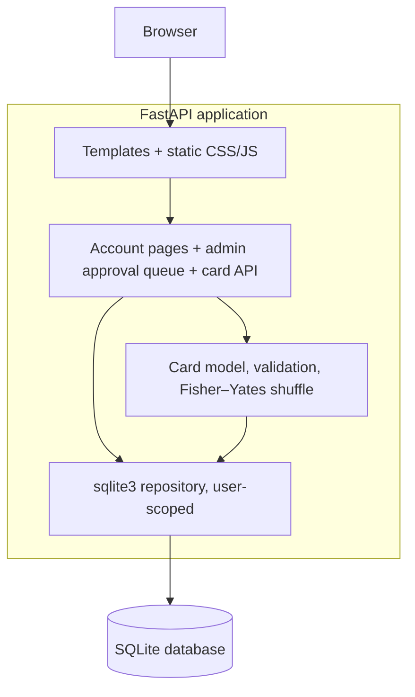

# Architecture (as built, 2026-11-24)

**Status:** Implemented and tested locally. HTTPS deployment and SQLite backups remain backlog work (`BL-022`, `BL-023`). This document describes the code in `src/virtual_index_card/`, not a proposal.

## Product shape

A hosted FastAPI web application with one private deck per account. Accounts are created by an **administrator** after approving a visitor's request; the administrator receives the new account's credentials to deliver out of band. Notes are plain text; each card has a front and back. The management page lists cards newest-created first for CRUD; Review shows one card at a time in the saved deck order and is the only page offering a shuffle control. Shuffle order is stored in SQLite and survives reloads, independently of the management view's creation order.

## Components

| File | Responsibility |
|---|---|
| `app.py` | Route definitions, sessions, CSRF checks, admin approval queue, template rendering |
| `admin.py` | `ensure_admin()` used by the CLI and the startup bootstrap |
| `create_admin.py` | `python -m virtual_index_card.create_admin` CLI (create or promote an admin) |
| `config.py` | `Settings` from `VIC_DATABASE_PATH`, `VIC_SESSION_TTL_SECONDS`, `VIC_COOKIE_SECURE`, `VIC_ADMIN_USERNAME`, `VIC_ADMIN_PASSWORD` |
| `db.py` | Connection factory, schema creation, `PRAGMA user_version = 2`, in-place v1 → v2 migration |
| `domain.py` | `Card`, note validation, Fisher–Yates shuffle with injectable RNG |
| `repository.py` | All SQL; every card query filters by `user_id` |
| `security.py` | PBKDF2 password hashing, random tokens, constant-time comparison |
| `templates/` | Base layout, login, account-request form, admin queue + credentials page, deck page |
| `static/` | CSS flip transform and fetch-based UI interactions |

## Data model

SQLite schema version 2 contains:

- `users(id, username UNIQUE NOCASE, salt, password_hash, role, created_at)` — `role` is `admin` or `user` (existing v1 accounts become `user`)
- `sessions(token_hash PRIMARY KEY, user_id, expires_at, created_at)`
- `cards(id, user_id, front, back, position, created_at, updated_at)`
- `account_requests(id, username, contact, note, status, created_at, decided_at, decided_by, created_user_id)` — `status` is `pending`, `approved`, or `rejected`

Indexes cover session expiry, `(user_id, position)`, and request status. Foreign keys are enabled. No plaintext password or raw session token is stored. Version 1 databases are migrated in place on startup (additive only: `users.role` plus the new table); a mismatched `PRAGMA user_version` still fails loudly without touching data.

## Interfaces

| Method | Path | Purpose | Auth |
|---|---|---|---|
| `GET` | `/health` | Health check | None |
| `GET`/`POST` | `/register` | Account-request form / file a pending request | None |
| `GET` | `/register/received` | Confirmation after submitting a request | None |
| `GET` | `/admin/requests` | Request queue: pending list + recent decisions | Admin |
| `GET` | `/admin/users` | All accounts with role, card count, created date | Admin |
| `GET`/`POST` | `/admin/profile` | Admin's own username/password; current password required; other sessions invalidated on password change | Admin + CSRF form token |
| `POST` | `/admin/users/{id}/delete` | Delete a non-admin account (cards/sessions cascade) | Admin + CSRF form token |
| `POST` | `/admin/requests/{id}/approve` | Create account from a pending request; credentials shown once | Admin + CSRF form token |
| `POST` | `/admin/requests/{id}/reject` | Reject a pending request | Admin + CSRF form token |
| `POST` | `/admin/users/{id}/reset-password` | Generate a new temporary password and sign the user out | Admin + CSRF form token |
| `GET`/`POST` | `/login` | Login form / start session | None |
| `POST` | `/logout` | End session | Session + CSRF form token |
| `GET` | `/` | Newest-created-first card management page | Session |
| `GET` | `/review?index=N` | Single-card Review in saved order; shuffle control | Session |
| `POST` | `/api/cards` | Create card | Session + `X-CSRF-Token` |
| `PATCH` | `/api/cards/{id}` | Edit card | Session + CSRF |
| `DELETE` | `/api/cards/{id}` | Delete card | Session + CSRF |
| `POST` | `/api/deck/shuffle` | Persist new Review order (called from Review UI) | Session + CSRF |

## Key flows

1. **Request/approval/login:** a visitor files an account request (desired account name, optional contact/note). An administrator reviews `/admin/requests`; approving creates the account with the requested or an edited account name and either an admin-chosen or a generated temporary password, shown once on the result page. Approving/rejecting is decided atomically with `UPDATE ... WHERE status = 'pending'` so a decided request cannot be re-decided. Reset issues a new temporary password and deletes the user's sessions. Login hashes with PBKDF2-HMAC-SHA256 and a per-user salt; sessions store only SHA-256 hashes and are conveyed in HttpOnly cookies plus a readable CSRF cookie.
2. **Flip:** the card's button toggles `aria-pressed` and a CSS class; the 3D transform reveals the back face. No server call.
3. **CRUD:** JavaScript sends JSON with the CSRF header; the route validates text, writes through the repository, and the management page reloads sorted by `created_at DESC, id DESC`. Edits and Review shuffles do not change this view's order.
4. **Shuffle:** The control appears only in Review (disabled with one card, absent with none). `shuffled_cards()` reorders with Fisher–Yates, positions are rewritten in one transaction, and the browser navigates to `/review` to start at the first card of the saved new order. Reload uses the same order.
5. **Review:** `/review` reads the saved `position` order, shows one card with a `?index=` cursor, and uses the shared flip handler. Previous/next links wrap around; arrow keys also navigate. No server call is needed to flip.

## Security posture

- Every card query is scoped to the authenticated `user_id`; cross-account IDs return 404.
- Admin-only routes require role `admin` (403 otherwise); the queue decisions are atomic and audited via `decided_by`/`decided_at`.
- Generated temporary passwords use an unambiguous alphabet and are shown once, never stored; resets sign the user out everywhere.
- User notes are escaped by Jinja and inserted as text, never `innerHTML`.
- Cookies are `SameSite=Lax`; `Secure` is enabled when `VIC_COOKIE_SECURE=true`.
- Expired sessions are removed when a new session starts.
- No secrets or database files are committed.

## Runtime and deployment

Run with `uv run uvicorn virtual_index_card.app:app` after `uv sync --group dev`. The database path is configurable; the parent directory is created automatically. The first start creates the schema; a mismatched `PRAGMA user_version` raises an actionable error.

HTTPS/reverse proxy, production secrets management, and scheduled backups are **not yet implemented** and are tracked as `BL-022` and `BL-023`. Do not expose this app publicly until those are complete.

## Testing

`uv run pytest -q` runs 65 tests: domain/shuffle and username/password invariants, password/token helpers, repository isolation, migration of a synthetic v1 database to v2, and FastAPI integration coverage for the request → approval → login flow, role gating, CSRF, rejection, one-time credential display, password reset semantics, CRUD, newest-first management, persisted Review shuffle, and account separation. A live `uvicorn` smoke test with `curl` verified the same end-to-end flow.

## Known limitations

- One deck per account; multiple decks are `BL-001`.
- Plain text only; Markdown is `BL-004`.
- No automatic delivery of credentials — the administrator relays them out of band; mail-based recovery remains `BL-024`.
- No password reset when the administrator is unreachable; administrators reset passwords from the request queue or with `create_admin`.
- No HTTPS, backup automation, or CI yet (`BL-022`, `BL-023`, `BL-015`).
