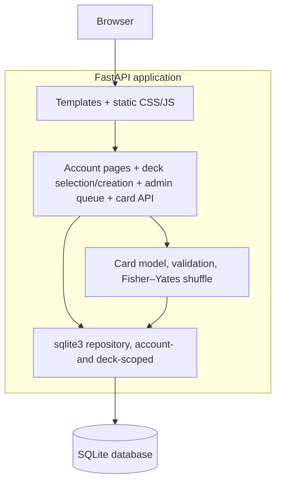

# Architecture (as built, 2026-11-27)

**Status:** Implemented and tested locally (2026-11-28). HTTPS deployment and SQLite backups remain backlog work (tracked as GitHub Issues). This document describes the code in `src/virtual_index_card/`, not a proposal.

## Product shape

A hosted FastAPI web application where each account can own multiple private decks. A new account starts with an empty `My Deck 1`; additional decks receive sequential account-local names (`My Deck 2`, and so on) unless the user supplies a custom name. Deck names are trimmed, limited to 100 characters, case-insensitively unique per account, and can be changed without affecting cards or Review order. Owners can permanently delete an empty deck after confirmation as long as the account retains at least one deck. Accounts are created by an **administrator** after approving a visitor's request; the administrator receives the new account's credentials to deliver out of band. Each card has a front and back supporting plain text or structured rich-text formatting (bold, italic, underline, and an accessible 4-color palette of black, green, red, and blue) up to 5,000 visible Unicode code points per side. The management page lists the selected deck's cards newest-created first for CRUD; Review shows one card at a time in that deck's saved order and is the only page offering a shuffle control. Each deck's order is stored independently in SQLite and survives reloads.

## Components

| File | Responsibility |
|---|---|
| `app.py` | Route definitions, sessions, CSRF checks, admin approval queue, template rendering |
| `admin.py` | `ensure_admin()` used by the CLI and the startup bootstrap |
| `create_admin.py` | `python -m virtual_index_card.create_admin` CLI (create or promote an admin) |
| `config.py` | `Settings` from `VIC_DATABASE_PATH`, `VIC_SESSION_TTL_SECONDS`, `VIC_COOKIE_SECURE`, `VIC_ENABLE_DOCS`, `VIC_ADMIN_USERNAME`, `VIC_ADMIN_PASSWORD`, `VIC_MAX_EXPORT_ROWS`, `VIC_MAX_EXPORT_BYTES`; also loads a `.env` file (real env vars win) |
| `db.py` | Connection factory, schema creation, `PRAGMA user_version = 5`, v1 → v2 → v3 → v4 → v5 migrations |
| `domain.py` | `Card`, note and deck-name validation, Fisher–Yates shuffle with injectable RNG |
| `formatting.py` | Rich-text AST allowlist validation, visible Unicode code-point checks, and safe HTML rendering |
| `repository.py` | All SQL, including deck shares; deck and card queries are scoped to the owning `user_id` and selected `deck_id` |
| `security.py` | PBKDF2 password hashing, random tokens, constant-time comparison |
| `templates/` | Base layout, shared card/editor components, login, account-request form, admin pages, deck, and review pages |
| `static/` | CSS flip/formatting/shared styles, rich-text editor, fetch-based UI interactions, and the anonymous `shared.js` viewer script |

## Data model

SQLite schema version 5 contains:

- `users(id, username UNIQUE NOCASE, salt, password_hash, role, created_at)` — `role` is `admin` or `user` (existing v1 accounts become `user`)
- `decks(id, user_id, name, created_at)` — account-owned decks with case-insensitive per-account name uniqueness; a composite unique key supports card ownership enforcement
- `sessions(token_hash PRIMARY KEY, user_id, expires_at, created_at)`
- `cards(id, user_id, deck_id, front, back, front_rich, back_rich, position, created_at, updated_at)` — composite foreign key `(deck_id, user_id)` prevents associating a card with another account's deck; `front` and `back` hold plain visible text while nullable `front_rich` and `back_rich` hold a canonical JSON formatting document (`NULL` for plain-text cards)
- `account_requests(id, username, contact, note, status, created_at, decided_at, decided_by, created_user_id)` — `status` is `pending`, `approved`, or `rejected`
- `deck_shares(id, deck_id, user_id, token_hash UNIQUE, created_at, revoked_at)` — one row per issued public link; only the SHA-256 of the bearer token is stored, `revoked_at` marks rotation/revocation, and the composite foreign key `(deck_id, user_id)` cascades so deleting a deck destroys its links

Indexes cover session expiry, account/deck card position, request status, and active deck shares. Foreign keys are enabled. No plaintext password or raw session token is stored. Existing v1–v4 databases migrate in place: v1/v2 databases upgrade through `My Deck 1` creation, v3 → v4 adds `front_rich` and `back_rich` with `NULL` values so existing plain-text cards keep their exact text, IDs, timestamps, and Review positions without interpreting markup-like characters as HTML, and v4 → v5 adds the `deck_shares` table without touching existing rows. A mismatched `PRAGMA user_version` fails loudly.

## Interfaces

| Method | Path | Purpose | Auth |
|---|---|---|---|
| `GET` | `/health` | Health check | None |
| `GET` | `/docs`, `/redoc`, `/openapi.json` | Interactive API docs and OpenAPI schema; 404 unless `VIC_ENABLE_DOCS=true` | None |
| `GET`/`POST` | `/register` | Account-request form / file a pending request | None |
| `GET` | `/register/received` | Confirmation after submitting a request | None |
| `GET` | `/admin/requests` | Request queue: pending list + recent decisions | Admin |
| `GET` | `/admin/users` | All accounts with role, card count, created date | Admin |
| `GET`/`POST` | `/admin/profile` | Admin's own username/password; current password required; other sessions invalidated on password change | Admin + CSRF form token |
| `POST` | `/admin/users/{id}/delete` | Delete a non-admin account (cards/sessions cascade) | Admin + CSRF form token |
| `POST` | `/admin/requests/{id}/approve` | Create account from a pending request; credentials shown once | Admin + CSRF form token |
| `POST` | `/admin/requests/{id}/reject` | Reject a pending request | Admin + CSRF form token |
| `POST` | `/admin/users/{id}/reset-password` | Generate a new temporary password and sign the user out | Admin + CSRF form token |
| `GET`/`POST` | `/login` | Login form / start session | None |
| `POST` | `/logout` | End session | Session + CSRF form token |
| `GET` | `/?deck_id=N` | Newest-created-first management page for selected deck; missing ID selects first deck | Session |
| `POST` | `/decks` | Create a custom-named deck, or the next sequential name when blank | Session + CSRF form token |
| `POST` | `/decks/{id}/rename` | Rename an account-owned deck | Session + CSRF form token |
| `POST` | `/decks/{id}/delete` | Permanently delete an empty owned deck while retaining at least one | Session + CSRF form token |
| `GET` | `/review?deck_id=N&index=M` | Single-card Review in selected deck's saved order; shuffle control | Session |
| `POST` | `/decks/{id}/share` | Create a public read-only link; the full URL is shown once | Session + CSRF form token |
| `POST` | `/decks/{id}/share/rotate` | Revoke the current link and issue a new one (shown once) | Session + CSRF form token |
| `POST` | `/decks/{id}/share/revoke` | Revoke the deck's active public link | Session + CSRF form token |
| `GET` | `/s/{token}?index=M` | Anonymous read-only view of one shared deck in saved order | None (bearer token) |
| `GET` | `/decks/{id}/export.json` | Versioned JSON export of one owned deck; 413 past the configured limits | Session |
| `POST` | `/api/cards?deck_id=N` | Create card in selected deck; missing ID selects first deck | Session + `X-CSRF-Token` |
| `PATCH` | `/api/cards/{id}?deck_id=N` | Edit a selected-deck card | Session + CSRF |
| `DELETE` | `/api/cards/{id}?deck_id=N` | Delete a selected-deck card | Session + CSRF |
| `POST` | `/api/deck/shuffle?deck_id=N` | Persist selected deck's new Review order | Session + CSRF |

## Key flows

1. **Request/approval/login:** a visitor files an account request (desired account name, optional contact/note). An administrator reviews `/admin/requests`; approving creates the account with the requested or an edited account name and either an admin-chosen or a generated temporary password, shown once on the result page. Approving/rejecting is decided atomically with `UPDATE ... WHERE status = 'pending'` so a decided request cannot be re-decided. Reset issues a new temporary password and deletes the user's sessions. Login hashes with PBKDF2-HMAC-SHA256 and a per-user salt; sessions store only SHA-256 hashes and are conveyed in HttpOnly cookies plus a readable CSRF cookie.
   **Account management:** `/admin/users` lists every account with role, card count, and creation date; deletes are permanent and limited to non-admin accounts. `/admin/profile` lets an administrator change their own username and password (current password required). A password change deletes every other session for that account but keeps the current one, so a routine rotation does not force a re-login.
2. **Flip:** the card's button toggles `aria-pressed` and a CSS class; the 3D transform reveals the back face. No server call.
3. **CRUD:** JavaScript sends JSON with the CSRF header; the route validates text, writes through the repository, and the management page reloads sorted by `created_at DESC, id DESC`. Edits and Review shuffles do not change this view's order.
4. **Deck creation, naming, selection, and deletion:** Each account starts with `My Deck 1`. The management and Review pages list only that account's decks; creating a deck uses a trimmed custom name or the next sequential name and opens it. Owners can rename a deck without changing its cards or Review order. Names are limited to 100 characters and protected by a case-insensitive per-account database uniqueness constraint. An owner may permanently delete an empty deck after browser confirmation, but a single conditional delete rejects non-empty and last-deck requests atomically. `deck_id` is resolved against the current account on every page and API request; unknown or foreign IDs return 404. Requests without an ID use that account's first deck for backwards compatibility; invalid or foreign IDs return 404.
5. **Shuffle:** The control appears only in Review (disabled with one card, absent with none). `shuffled_cards()` reorders the selected deck with Fisher–Yates, positions are rewritten in one transaction, and the browser stays on that deck at the first card of its saved new order. Reload uses the same order.
6. **Review:** `/review` reads the selected deck's saved `position` order, shows one card with a `?index=` cursor, and uses the shared flip handler. Previous/next links retain the selected `deck_id` and wrap around; arrow keys also navigate. No server call is needed to flip.
7. **Public sharing:** an owner posts to `/decks/{id}/share` (CSRF required). The server revokes any existing link for that deck, generates `secrets.token_urlsafe(32)`, stores only `sha256(token)`, and returns the full URL exactly once — mirroring the shown-once rule for temporary passwords. The shown-once page also displays a locally generated inline SVG QR code for the same URL; it uses no external image service and is itself a bearer secret. `GET /s/{token}` hashes the presented token, resolves an unrevoked share, and renders `shared_deck.html`, a standalone template with no authenticated navigation, no CSRF meta tag, and no mutating routes. Unknown, revoked, rotated, and deleted-deck tokens all return the same 404 page. Rotation is "revoke + issue"; revocation stamps `revoked_at`. Shared responses carry `Cache-Control: no-store`, `X-Robots-Tag: noindex, nofollow`, and `Referrer-Policy: no-referrer` so the token in the URL never leaks to other origins.
8. **Export:** `GET /decks/{id}/export.json` serialises one owned deck to `{format, version, deck:{name}, cards:[{front, back, front_rich, back_rich}]}`. It enforces `VIC_MAX_EXPORT_ROWS` and `VIC_MAX_EXPORT_BYTES` (HTTP 413), never includes account ids, credentials, or share tokens, and is session-scoped, so foreign deck ids return 404.

## Security posture

- Every card operation is scoped to the authenticated `user_id` and validated `deck_id`; cross-account deck/card IDs return 404. The composite database foreign key also prevents mismatched card/deck ownership.
- Admin-only routes require role `admin` (403 otherwise); the queue decisions are atomic and audited via `decided_by`/`decided_at`.
- Generated temporary passwords use an unambiguous alphabet and are shown once, never stored; resets sign the user out everywhere.
- User notes are never stored or rendered as untrusted HTML: plain-text cards are escaped by Jinja/MarkupSafe, and formatted cards are validated on a strict server allowlist into a canonical JSON AST rendered with CSS classes only (no inline `style` attributes or active elements).
- Public deck links are bearer secrets: only SHA-256 hashes are stored, the full URL and its locally generated QR code are displayed once on a `no-store` page, and lookups are scoped to unrevoked shares. Anyone who sees or scans either can read the deck. Public viewers get a standalone template with no session, no CSRF token, and no write routes; all mutation endpoints require a session and return 401/403/404 anonymously.
- Shared responses are `no-store`, `noindex, nofollow`, and `Referrer-Policy: no-referrer`, so revoked content is not retained by shared caches or indexes and the token is not sent to third parties via `Referer`.
- Cookies are `SameSite=Lax`; `Secure` is enabled when `VIC_COOKIE_SECURE=true`.
- Expired sessions are removed when a new session starts.
- No secrets or database files are committed.

## Runtime and deployment

Run with `uv run uvicorn virtual_index_card.app:app` after `uv sync --group dev`. The database path is configurable; the parent directory is created automatically. The first start creates the schema; a mismatched `PRAGMA user_version` raises an actionable error.

HTTPS/reverse proxy, production secrets management, and scheduled backups are **not yet implemented** and are tracked as GitHub Issues. Do not expose this app publicly until those are complete. The interactive API docs and OpenAPI schema are served only when `VIC_ENABLE_DOCS=true`, so a default deployment exposes no unauthenticated routes beyond `/health`, `/register`, `/login`, and the static assets.

## Testing

The pytest suite covers domain/shuffle, rich-text canonicalization/contrast/sanitization, and username/password invariants, password/token helpers, repository isolation, v1–v4 schema migrations, account approval and login, role gating, CSRF, CRUD, newest-first management, persisted Review shuffle, and account separation. Multi-deck coverage verifies sequential names, schema migration, selected-deck card/Review isolation, and rejection of foreign deck IDs. Sharing coverage verifies anonymous read-only access, cache/indexing headers, revocation, rotation, deleted-deck cascade, hashed-only token storage, indistinguishable failures, and that no mutation route accepts an anonymous caller. Export coverage verifies the versioned envelope, owned-only access, and the configured limits. Run `uv run pytest -q` to execute the suite.

## Known limitations

- Public read-only sharing (#4) and one-way JSON export are implemented. **Import** is not: #5 also requires importing a file into a new deck with collision handling and upload limits.
- Card formatting is intentionally limited to bold, italic, underline, and the fixed 4-color accessible palette (no block-quote button, orange/pink colors, images, links, tables, lists, headings, or custom fonts). Existing blockquote records still render.
- No automatic delivery of credentials — the administrator relays them out of band; mail-based delivery remains open backlog work.
- No self-service password reset. Administrators reset non-admin passwords from **Admin → Users** (or the approved row in the request queue), and can rotate their own password on **Admin → Profile**; `create_admin --password` covers the rest.
- No HTTPS, backup automation, or CI yet (all tracked as GitHub Issues).
- Public links never expire on their own and there is no rate limiting on `/s/{token}`; both are deliberate scope decisions recorded in #4.
