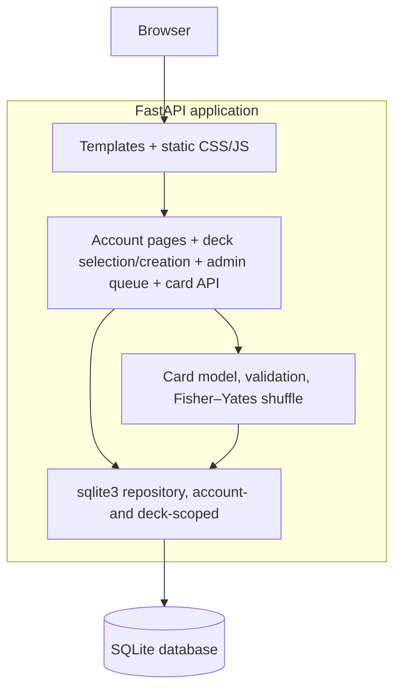

# Architecture (as built, 2026-11-24)

**Status:** Implemented and tested locally. HTTPS deployment and SQLite backups remain backlog work (`BL-022`, `BL-023`). This document describes the code in `src/virtual_index_card/`, not a proposal.

## Product shape

A hosted FastAPI web application where each account can own multiple private decks. A new account starts with an empty `My Deck 1`; additional decks receive sequential account-local names (`My Deck 2`, and so on) unless the user supplies a custom name. Deck names are trimmed, limited to 100 characters, case-insensitively unique per account, and can be changed without affecting cards or Review order. Owners can permanently delete an empty deck after confirmation as long as the account retains at least one deck. Accounts are created by an **administrator** after approving a visitor's request; the administrator receives the new account's credentials to deliver out of band. Notes are plain text; each card has a front and back. The management page lists the selected deck's cards newest-created first for CRUD; Review shows one card at a time in that deck's saved order and is the only page offering a shuffle control. Each deck's order is stored independently in SQLite and survives reloads.

## Components

| File | Responsibility |
|---|---|
| `app.py` | Route definitions, sessions, CSRF checks, admin approval queue, template rendering |
| `admin.py` | `ensure_admin()` used by the CLI and the startup bootstrap |
| `create_admin.py` | `python -m virtual_index_card.create_admin` CLI (create or promote an admin) |
| `config.py` | `Settings` from `VIC_DATABASE_PATH`, `VIC_SESSION_TTL_SECONDS`, `VIC_COOKIE_SECURE`, `VIC_ADMIN_USERNAME`, `VIC_ADMIN_PASSWORD` |
| `db.py` | Connection factory, schema creation, `PRAGMA user_version = 3`, v1 → v2 → v3 and v2 → v3 migrations |
| `domain.py` | `Card`, note validation, Fisher–Yates shuffle with injectable RNG |
| `repository.py` | All SQL; deck and card queries are scoped to the owning `user_id` and selected `deck_id` |
| `security.py` | PBKDF2 password hashing, random tokens, constant-time comparison |
| `templates/` | Base layout, login, account-request form, admin queue + credentials page, deck page |
| `static/` | CSS flip transform and fetch-based UI interactions |

## Data model

SQLite schema version 3 contains:

- `users(id, username UNIQUE NOCASE, salt, password_hash, role, created_at)` — `role` is `admin` or `user` (existing v1 accounts become `user`)
- `decks(id, user_id, name, created_at)` — account-owned decks with case-insensitive per-account name uniqueness; a composite unique key supports card ownership enforcement
- `sessions(token_hash PRIMARY KEY, user_id, expires_at, created_at)`
- `cards(id, user_id, deck_id, front, back, position, created_at, updated_at)` — composite foreign key `(deck_id, user_id)` prevents associating a card with another account's deck
- `account_requests(id, username, contact, note, status, created_at, decided_at, decided_by, created_user_id)` — `status` is `pending`, `approved`, or `rejected`

Indexes cover session expiry, account/deck card position, and request status. Foreign keys are enabled. No plaintext password or raw session token is stored. Existing v1 databases pass through the v1 → v2 → v3 migrations; existing v2 databases migrate in place by creating `My Deck 1` for each account and moving existing card rows into it while preserving card IDs, content, timestamps, and Review positions. A mismatched `PRAGMA user_version` fails loudly.

## Interfaces

| Method | Path | Purpose | Auth |
|---|---|---|---|
| `GET` | `/health` | Health check | None |
| `GET`/`POST` | `/register` | Account-request form / file a pending request | None |
| `GET` | `/register/received` | Confirmation after submitting a request | None |
| `GET` | `/admin/requests` | Request queue: pending list + recent decisions | Admin |
| `GET` | `/admin/users` | All accounts with role, card count, created date | Admin |
| `GET`/`POST` | `/admin/profile` | Admin's own username/password; current password required; other sessions invalidated on password change | Admin + CSRF form token |
| `POST` | `/admin/users/{id}/delete` | Delete a non-admin account (cards/sessions cascade) | Admin + CSRF form token |
| `POST` | `/admin/requests/{id}/approve` | Create account from a pending request; credentials shown once | Admin + CSRF form token |
| `POST` | `/admin/requests/{id}/reject` | Reject a pending request | Admin + CSRF form token |
| `POST` | `/admin/users/{id}/reset-password` | Generate a new temporary password and sign the user out | Admin + CSRF form token |
| `GET`/`POST` | `/login` | Login form / start session | None |
| `POST` | `/logout` | End session | Session + CSRF form token |
| `GET` | `/?deck_id=N` | Newest-created-first management page for selected deck; missing ID selects first deck | Session |
| `POST` | `/decks` | Create a custom-named deck, or the next sequential name when blank | Session + CSRF form token |
| `POST` | `/decks/{id}/rename` | Rename an account-owned deck | Session + CSRF form token |
| `POST` | `/decks/{id}/delete` | Permanently delete an empty owned deck while retaining at least one | Session + CSRF form token |
| `GET` | `/review?deck_id=N&index=M` | Single-card Review in selected deck's saved order; shuffle control | Session |
| `POST` | `/api/cards?deck_id=N` | Create card in selected deck; missing ID selects first deck | Session + `X-CSRF-Token` |
| `PATCH` | `/api/cards/{id}?deck_id=N` | Edit a selected-deck card | Session + CSRF |
| `DELETE` | `/api/cards/{id}?deck_id=N` | Delete a selected-deck card | Session + CSRF |
| `POST` | `/api/deck/shuffle?deck_id=N` | Persist selected deck's new Review order | Session + CSRF |

## Key flows

1. **Request/approval/login:** a visitor files an account request (desired account name, optional contact/note). An administrator reviews `/admin/requests`; approving creates the account with the requested or an edited account name and either an admin-chosen or a generated temporary password, shown once on the result page. Approving/rejecting is decided atomically with `UPDATE ... WHERE status = 'pending'` so a decided request cannot be re-decided. Reset issues a new temporary password and deletes the user's sessions. Login hashes with PBKDF2-HMAC-SHA256 and a per-user salt; sessions store only SHA-256 hashes and are conveyed in HttpOnly cookies plus a readable CSRF cookie.
2. **Flip:** the card's button toggles `aria-pressed` and a CSS class; the 3D transform reveals the back face. No server call.
3. **CRUD:** JavaScript sends JSON with the CSRF header; the route validates text, writes through the repository, and the management page reloads sorted by `created_at DESC, id DESC`. Edits and Review shuffles do not change this view's order.
4. **Deck creation, naming, selection, and deletion:** Each account starts with `My Deck 1`. The management and Review pages list only that account's decks; creating a deck uses a trimmed custom name or the next sequential name and opens it. Owners can rename a deck without changing its cards or Review order. Names are limited to 100 characters and protected by a case-insensitive per-account database uniqueness constraint. An owner may permanently delete an empty deck after browser confirmation, but a single conditional delete rejects non-empty and last-deck requests atomically. `deck_id` is resolved against the current account on every page and API request; unknown or foreign IDs return 404. Requests without an ID use that account's first deck for backwards compatibility; invalid or foreign IDs return 404.
5. **Shuffle:** The control appears only in Review (disabled with one card, absent with none). `shuffled_cards()` reorders the selected deck with Fisher–Yates, positions are rewritten in one transaction, and the browser stays on that deck at the first card of its saved new order. Reload uses the same order.
6. **Review:** `/review` reads the selected deck's saved `position` order, shows one card with a `?index=` cursor, and uses the shared flip handler. Previous/next links retain the selected `deck_id` and wrap around; arrow keys also navigate. No server call is needed to flip.

## Security posture

- Every card operation is scoped to the authenticated `user_id` and validated `deck_id`; cross-account deck/card IDs return 404. The composite database foreign key also prevents mismatched card/deck ownership.
- Admin-only routes require role `admin` (403 otherwise); the queue decisions are atomic and audited via `decided_by`/`decided_at`.
- Generated temporary passwords use an unambiguous alphabet and are shown once, never stored; resets sign the user out everywhere.
- User notes are escaped by Jinja and inserted as text, never `innerHTML`.
- Cookies are `SameSite=Lax`; `Secure` is enabled when `VIC_COOKIE_SECURE=true`.
- Expired sessions are removed when a new session starts.
- No secrets or database files are committed.

## Runtime and deployment

Run with `uv run uvicorn virtual_index_card.app:app` after `uv sync --group dev`. The database path is configurable; the parent directory is created automatically. The first start creates the schema; a mismatched `PRAGMA user_version` raises an actionable error.

HTTPS/reverse proxy, production secrets management, and scheduled backups are **not yet implemented** and are tracked as `BL-022` and `BL-023`. Do not expose this app publicly until those are complete.

## Testing

The pytest suite covers domain/shuffle and username/password invariants, password/token helpers, repository isolation, schema migrations, account approval and login, role gating, CSRF, CRUD, newest-first management, persisted Review shuffle, and account separation. Multi-deck coverage verifies sequential names, schema-v2 data migration, selected-deck card/Review isolation, and rejection of foreign deck IDs. Run `uv run pytest -q` to execute the suite.

## Known limitations

- Decks can be created with generated or custom names, selected, renamed, and deleted when empty and not the account's last deck; sharing and import/export are not implemented.
- Plain text only; Markdown is `BL-004`.
- No automatic delivery of credentials — the administrator relays them out of band; mail-based recovery remains `BL-024`.
- No password reset when the administrator is unreachable; administrators reset passwords from the request queue or with `create_admin`.
- No HTTPS, backup automation, or CI yet (`BL-022`, `BL-023`, `BL-015`).
